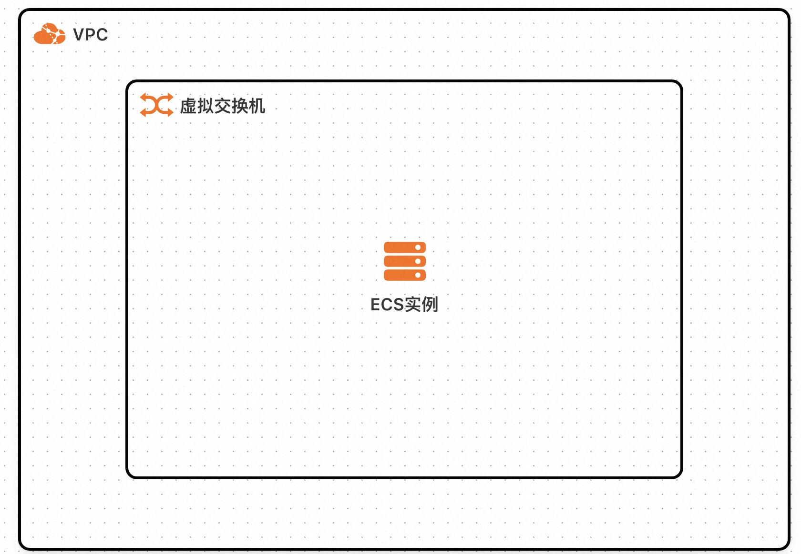
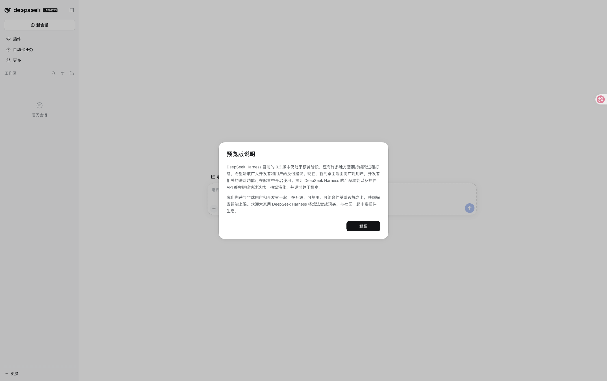
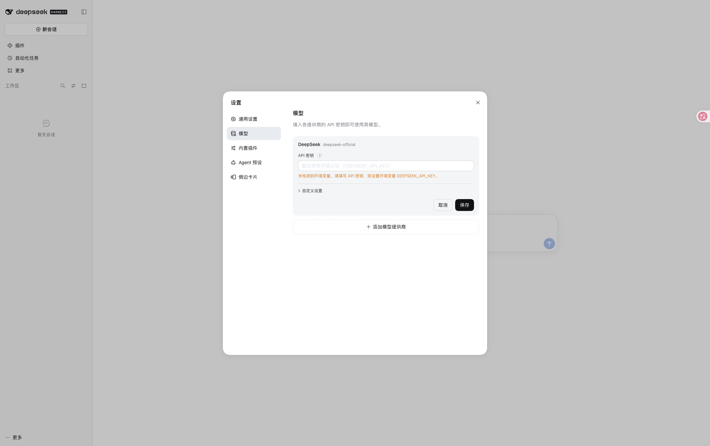
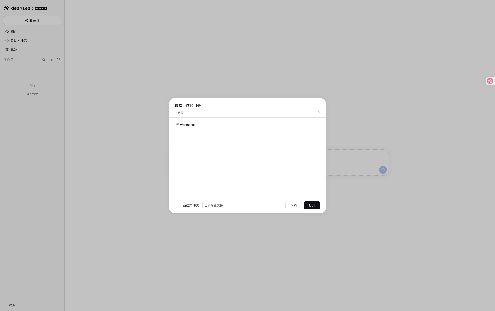
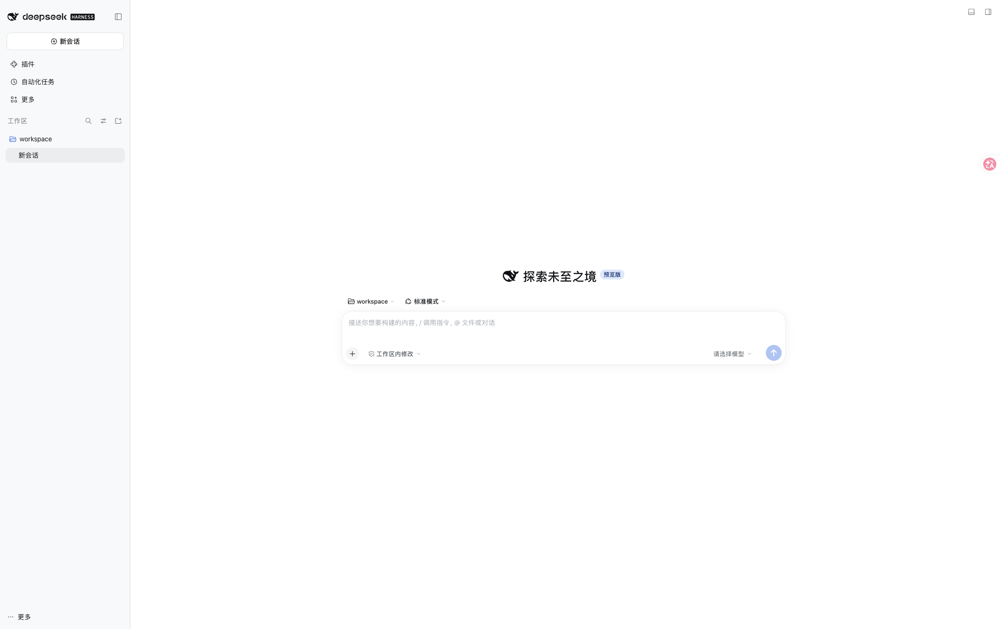

# Deepseek-Harness社区版计算巢部署文档

## 服务说明

Deepseek-Harness社区版是 DeepSeek AI 开源的 Agent Harness，提供浏览器 Web UI，可在页面中配置 DeepSeek 或 OpenAI 兼容模型，并选择工作区后运行代码代理任务。本计算巢服务采用单机 ECS 部署，ECS 镜像内已预置 Node.js 24.22.2、DeepSeek Harness（0.2.1-rc.5）Web UI 和 Nginx 反向代理。

该服务本身没有登录界面，因此访问入口已开启计算巢安全代理：用户从计算巢控制台的服务实例输出访问 Web UI，ECS 安全组仅放行安全代理出口网段访问 3080 端口，不直接对公网开放无鉴权 Web 服务。DeepSeek Harness 0.2.x 启动时会生成一次性访问 token，Nginx 在首次访问时自动用它换取签名 Cookie 并跳转，用户无需手动输入 token。

## 服务架构

本服务模板构建出的服务为单机 ECS 部署。DeepSeek Harness Web UI 在实例内部监听 `127.0.0.1:13080`，Nginx 监听 `0.0.0.0:3080` 并反向代理到本地 Web UI，计算巢安全代理基于服务实例输出地址访问 3080 端口。

安全代理只对外暴露 HTTPS 8443 网关，因此 Nginx 已关闭绝对重定向（`absolute_redirect off`）：首次访问的 302 保持为相对路径 `/?token=...`，token 换签名 Cookie 的跳转全程留在代理网关内完成。实例的 3080 端口不可从公网直达，访问 Web UI 请始终使用控制台输出的安全代理入口。



## 计费说明

通过此服务模板构建服务不产生费用。用户部署服务实例时，资源费用主要涉及：

- ECS 实例规格
- 系统盘容量

计费方式支持按量付费和包年包月，预估费用会在部署前实时展示。

## RAM账号所需权限

若使用 RAM 用户创建服务实例，需要在创建服务实例前为该 RAM 用户添加相应权限。

| 权限策略名称 | 备注 |
| --- | --- |
| AliyunECSFullAccess | 管理云服务器 ECS 的权限 |
| AliyunVPCFullAccess | 管理专有网络 VPC 的权限 |
| AliyunROSFullAccess | 管理资源编排 ROS 的权限 |
| AliyunComputeNestUserFullAccess | 管理计算巢服务用户侧资源的权限 |

## 服务实例部署流程

### 部署步骤

1. 打开计算巢服务实例创建页面，选择部署地域并填写实例规格、实例密码和网络参数。

   [部署链接](https://computenest.console.aliyun.com/service/instance/create/cn-hangzhou?type=user&ServiceId=service-252a17b1e4cc425ca5f0)

2. 确认询价明细后点击 **下一步：确认订单**，同意服务协议并点击 **立即创建**。

3. 等待服务实例部署完成。部署完成后，在服务实例详情页的 **输出** 区域查看 `WebUIAddress`。

4. 点击输出中的安全代理访问地址打开 Web UI。页面应展示 DeepSeek Harness 的新会话、设置和选择工作区入口。



## 首次使用配置

Deepseek Harness Web UI 打开后还不能直接发起会话，必须先完成模型和工作区配置。

### 1. 配置大模型

首次打开会弹出 **开始使用** 引导，点击 **添加 API Key** 可直接进入模型配置；也可以点击左下角 **更多 → 设置 → 模型**。



1. 在 **模型** 页签中，页面会列出 DeepSeek 提供方（`deepseek-official`）与「添加模型提供商」入口。
2. 任选一种方式完成模型接入：
   - 填写 DeepSeek API Key，使用 DeepSeek 官方模型。
   - 点击 **添加模型提供商 → 第三方模型提供商**，从内置目录（OpenAI、Anthropic、Kimi、Qwen 等）中选择并填写 API Key。
   - 点击 **添加模型提供商 → 自定义模型 API**，填写 Base URL、API Key 与模型 ID。
3. 点击 **保存** 完成配置。

未配置模型 API Key 时，Web UI 可以打开，但无法正常发起模型请求。

### 2. 选择工作区

1. 返回主页面，点击 **选择工作区**。
2. 在目录选择器中进入 **workspace**，点击 **打开**。



3. 工作区选择完成后，新会话输入框才可正常使用。



服务实例已在 ECS 上准备 `/opt/deepseek-harness/workspace` 作为默认工作目录，并在主目录下提供同名入口供目录选择器直接选取；DeepSeek Harness 的会话、凭据、存储和附件数据保存在 `/opt/deepseek-harness/dsh-home` 下。

## 运维说明

如需登录 ECS 排查服务状态，可使用实例密码远程连接 ECS 后执行：

```bash
sudo systemctl status deepseek-harness.service
sudo systemctl status nginx.service
sudo journalctl -u deepseek-harness.service -n 100 --no-pager
```

服务启动脚本位于 `/opt/deepseek-harness/bin/start-dsh-web`，应用日志位于 `/opt/deepseek-harness/logs/service.log`。

Nginx 站点配置位于 `/etc/nginx/conf.d/deepseek-harness.conf`，其中的 `absolute_redirect off` 不能删除，否则安全代理打开的页面会跳向不可达的 3080 端口而卡住。

## 注意事项

- DeepSeek Harness 当前为 developer preview，上游未来版本可能存在破坏性变更。
- 用户在 Web UI 中配置的模型 API Key 会保存在服务实例本地持久化目录中，请妥善管理实例访问权限。

## 官方链接

- [DeepSeek Harness GitHub](https://github.com/deepseek-ai/deepseek-harness)
